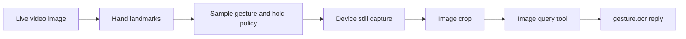

<!--
  SPDX-FileCopyrightText: Copyright (c) 2026 NVIDIA CORPORATION & AFFILIATES. All rights reserved.
  SPDX-License-Identifier: Apache-2.0
-->

# Gesture capture

The `gesture-capture` sample reads hand landmarks from mono video and uses a
camera-box gesture to request a separate still photograph. It crops the photo
and reads text through the configured VLM service. The sample launches a hub
and worker; the VLM service runs separately. Start commands and common settings
are in the [sample README](https://github.com/NVIDIA/xr-ai/tree/main/agent-samples/gesture-capture).

## Compose the capabilities



`GestureCaptureAgent.step()` shows the composition. `CurrentFrameTool` selects
live images with photo fallback disabled. `HandTrackingTool` interprets a
selected image and returns 21 landmarks per hand; it knows nothing about
capture or gestures. The sample recognizes two opposing thumb/index L shapes,
checks that their endpoints approximate the other rectangle corners, and uses
a stable hold followed by an observed release to trigger once.

`StillCaptureTool` always requests a new device photograph, even with fresh
video available. It returns the actual image dimensions and an opaque image
reference. `ImageCropTool` operates on that reference independently of hand
tracking. `ImageQueryTool` resolves the cropped reference through the typed
VLM service. Other applications can replace any of the gesture, acquisition,
crop, or inference steps independently. Tool execution uses the existing Relay
boundary; raw pixels do not enter tool requests or results.

The worker owns one polling task per participant and one shared local hand
detector. IMAGE mode keeps observations independent across participants.
Native calls are serialized off the event loop, and detector teardown waits
for native inference to finish even after a polling coroutine is cancelled.
Disconnect cancels the participant task and releases its image handles.
A missing frame or inference failure breaks hold continuity without rearming
a held gesture. Duplicate observations cannot advance the hold timer.

## Provision the hand model

The optional `hand-tracking` extra uses the reviewed MediaPipe 0.10.31 release.
Its wheels support Linux x86-64 with glibc 2.28+, macOS ARM64, and Windows x64.
There is no Linux ARM64 wheel for this release. The sample launcher and hub
retain their existing platform requirements; wheel availability alone does not
establish that the full sample runs on Windows or macOS.

The model is provisioned explicitly; the SDK does not download it. From
`agent-samples/gesture-capture/`:

```bash
mkdir -p models
curl --fail --location \
  https://storage.googleapis.com/mediapipe-models/hand_landmarker/hand_landmarker/float16/1/hand_landmarker.task \
  --output models/hand_landmarker.task
printf '%s  %s\n' \
  fbc2a30080c3c557093b5ddfc334698132eb341044ccee322ccf8bcf3607cde1 \
  models/hand_landmarker.task | sha256sum --check
```

Both the package and the official model card identify Apache 2.0 licensing.
The wheel also includes a Lucent permissive notice. Refer to the repository's
[third-party notices](https://github.com/NVIDIA/xr-ai/blob/main/THIRD_PARTY_NOTICES.md#mediapipe-hand-landmarks)
for artifact scope, transitive dependencies, and attribution files. The
[official model card](https://storage.googleapis.com/mediapipe-assets/Model%20Card%20Hand%20Tracking%20%28Lite_Full%29%20with%20Fairness%20Oct%202021.pdf)
describes limitations with occlusion, gloves, motion blur and lighting; gesture
recognition here is a demonstration requiring target-camera tuning.

## Configure the image path

Select **Live** camera mode in the web client. The existing capture callback
now handles live-mode photograph requests through the browser's native
`ImageCapture.takePhoto()` API. It requests the maximum photo dimensions
reported by the camera without changing video constraints. A camera may return
less than 4K or pause video during exposure. Unsupported browsers reject the
request; the explicit still tool does not substitute a video snapshot.

Custom device applications implement `onImageCaptureRequested` with their own
photo API. This permits image-only sensor resolutions while low-resolution
video continues to supply hand observations. The existing request, response,
and cancellation protocol carries the encoded image independently of video.
An aborted request suppresses delivery; a device exposure already started by
its native camera API may still finish. Native iOS and Android high-resolution photo adapters for live mode
are separate platform work; this sample's built-in implementation is web-only.

Set `aligned_photo: true` only after verifying that video and stills come
from the same camera, with the same optical framing and orientation. Coordinates
refer to source pixels, independent of a mirrored preview. EXIF orientation is
normalized when processing stills. The sample rejects different photo and video
aspect ratios. Equal aspect ratios cannot detect digital zoom, stabilization,
lens switching, changed field of view, or scene motion between gesture and
exposure; these need device-specific calibration or alignment. Keep the camera
and framed target steady until capture finishes.

## Settings and output

The orchestrator selects `yaml/device_io_hub.yaml` and
`yaml/gesture_capture_worker.yaml`. The latter resolves `model_path` and
`models` relative to its own directory. `models.json` owns the VLM adapter and
endpoint; it does not deploy that server. Restart the sample after editing
settings. Model-server endpoint changes must also match the separately started
service; refer to {doc}`/guides/customizing-model-servers`.

The worker YAML owns observation cadence, hold/release durations, the maximum
observation gap, movement and geometric tolerances, alignment acknowledgement,
and the OCR question. These are demonstration settings, not measured accuracy
claims. The current gesture returns an axis-aligned rectangle enclosing the
hands' framing corners, including for a rotated gesture.

Results are UTF-8 data messages on `gesture.ocr`, visible in the web client's
message log. A capture failure is logged and does not automatically retry
while the gesture remains held. Release both hands from the box pose before
trying again. Inference can be replaced by another image question or a separate
OCR consumer without modifying hand tracking or acquisition.
